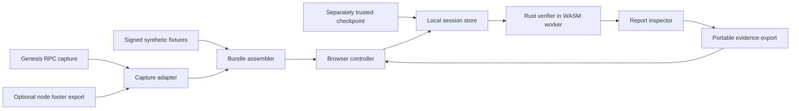

# Architecture

Status: proposed product architecture; a fixed-fixture native/WASM cryptographic experiment is implemented in C1. The [architecture PDF](architecture.pdf) provides five diagram sheets; this document defines the responsibilities and important details behind them.

## System boundary

Monocle's primary workflow is local verification. A static web host serves application assets. The browser imports evidence and a separately selected checkpoint, invokes a Rust/WASM worker, and displays the resulting report. A native read-only tool prepares fixtures and capture bundles. The MVP requires neither a Solana program nor a wallet connection.



Transport sources are untrusted inputs to the verifier. TLS, a familiar endpoint name, or a file digest does not establish the authenticity of a validator set. The selected trust context is a distinct input.

## Component responsibilities

| Component | Owns | Must not do |
| --- | --- | --- |
| Capture adapter | Decode a supported source envelope and preserve captured bytes/context | Label a fetch as a successful verification |
| Bundle assembler | Versioned packaging, provenance, checkpoint reference | Silently rewrite signed bytes or manufacture absent context |
| Browser controller | User actions, run IDs, file limits, worker lifecycle | Make its own conflicting cryptographic verdict |
| Session store | Original bytes, derived copies, selected checkpoint, reports | Mutate the baseline or import a trusted flag from a bundle |
| Rust core | Parsing, profile/context checks, crypto checks, quorum, finality policy | Fetch replacement context from the network during a run |
| Report inspector | Trace, stake participation, evidence scope, assumptions | Hide unperformed checks behind a success badge |
| Exporter | Evidence, mutation log, profile/checkpoint identities, prior reports | Treat a stored result as proof when re-imported |

The native tool and worker should call the same core for the same profile. C1 demonstrates the shared leaf-cryptography path; full certificate integration remains to be implemented. See [compatibility.md](compatibility.md).

## Proposed source layout

```text
crates/
  monocle-core/       # deterministic verification and report types
  monocle-wasm/       # minimal browser boundary around the core
  monocle-cli/        # fixture generation, capture packaging, local inspection
apps/
  web/               # React/TypeScript controller and worker client
fixtures/            # synthetic and captured public evidence, with provenance
scripts/             # repeatable build, fixture, and verification utilities
docs/                # public design, research, usage, and status
commits/             # local ignored checkpoint handoffs
```

This product layout is planned. C1 lives separately in `experiments/bls-compat/` and `experiments/browser/`, with reproducible scripts and a pinned Rust workspace. It does not create product components merely to imply progress.

## Core interfaces

`VerifyRequest` contains a run identity, bundle bytes, an explicit checkpoint selection, and a supported profile identity. The core resolves immutable inputs and returns a `VerificationReport` rather than mutating UI state.

A report includes:

- Bundle, profile, and checkpoint identities.
- Per-certificate check outcomes and diagnostics.
- Signer ranks and exact stake totals for each applicable certificate.
- Certified slot and block ID where that certificate kind binds them.
- Overall conclusion, evidence scope, and explicit assumptions.

Network transport, timestamps, human-readable labels, and source claims are provenance. They are not signed merely because the bundle contains them. Contradictory parsed/display fields must fail consistency checks or be replaced with values decoded from authoritative bytes.

## Input and result model

| Object | Important fields and rules |
| --- | --- |
| `ProofBundle` | Schema version, profile ID, cluster context, certificate envelopes, capture metadata, checkpoint reference, optional parent digest and mutations |
| `CertificateEnvelope` | Kind, source format, raw bytes, signature and signer encoding as defined by the profile; source and normalized representations must agree |
| `EpochCheckpoint` | Epoch/context, canonical ordered ranks, BLS keys, stake, protocol denominator, qualification provenance; separately trusted |
| `ProtocolProfile` | Immutable upstream revision, allowed formats, payload rules, cryptographic encodings/ciphersuite, supported certificate rules |
| `MutationRecord` | Original identity, changed field/bytes, operation, before/after values, derived identity |
| `VerificationReport` | Per-check outcomes, per-certificate results, evidence scope, conclusion, assumptions |

The JSON-facing representation must not lose `u64` precision. Decimal strings are the proposed transport for slots and stake values; the Rust core validates their exact ranges. Digests should use a specified representation: initially hash preserved bytes rather than an unspecified JSON key order. Semantic canonicalization, if introduced, needs a separate documented rule.

## Verification lifecycle

1. Enforce size/count limits and recognize schema/profile.
2. Resolve the independently selected checkpoint and compare context.
3. Decode signer selections under the pinned format and qualify keys.
4. Reconstruct the exact signed payload(s), validate encodings, and verify signatures.
5. Compute stake thresholds with checked integer operations.
6. Compose supported certificate evidence into a scoped conclusion.
7. Return all completed checks and reasons for skipped checks.

Invalid input can fail early. Missing prerequisites leave dependent checks unperformed. The evaluator must not assume that every certificate present in a bundle is relevant to the requested claim; define claim selection and handling of extra certificates before accepting multi-certificate bundles.

## Browser execution and persistence

Use a worker so cryptographic computation does not block input and rendering. Give runs stable identifiers and ignore stale replies. Replacing an input invalidates the corresponding displayed report until a fresh run completes. A worker crash should produce a clear execution error, not a cached verification success.

Start with in-memory session state and explicit local file export. IndexedDB caching can follow if it provides a concrete user benefit. Imported reports are informational until recomputed. No server-side database or user account is required for the MVP.

## Trust and operational boundaries

Checkpoint authenticity is a user/operator assumption in the fixed-checkpoint MVP. Key possession, public-key encoding validity, correct stake data, and the authenticity of the epoch set are separate requirements. Captured source metadata cannot satisfy them on its own.

Application delivery is also part of practical trust: a maliciously replaced verifier can lie about its checks. Reproducible builds, dependency pinning, and local execution help inspection, but the MVP should not claim to solve browser supply-chain trust.

Ordinary certificate capture may require node access and a custom exporter. That integration is outside the deterministic verification core and must not become a hidden dependency of the offline demonstration.
